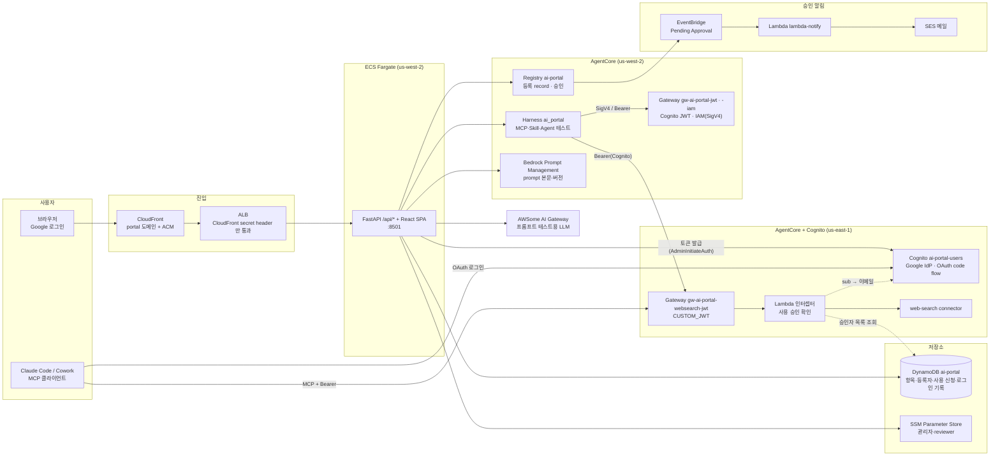
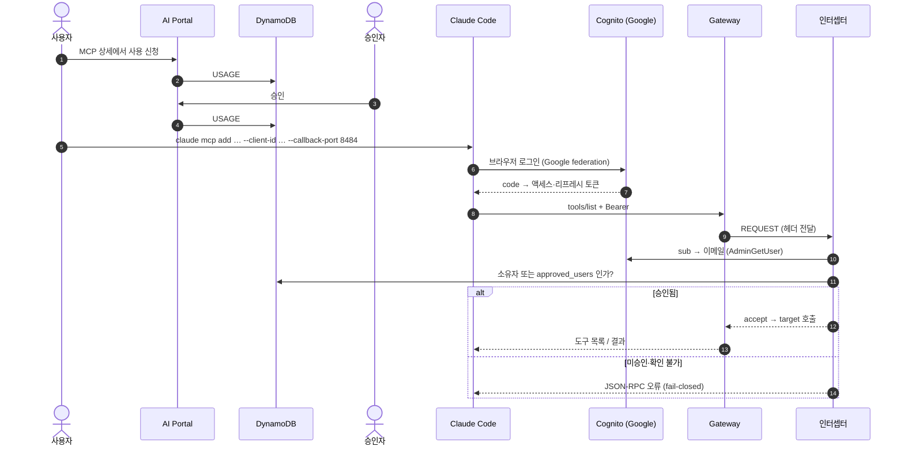

# AI Portal

AWS Agent Registry(Amazon Bedrock AgentCore)의 기능을 UI와 함께 보여주는 웹.
Prompt · MCP · Agent · Skill 을 카탈로그로 탐색·등록하고, 등록 정보는 Agent Registry 로 관리합니다.

전체적인 architecture는 아래와 같습니다.


- 구조: FastAPI REST(`/api/*`) + React(Vite) SPA, 한 컨테이너(:8501)로 ECS 배포 (agentic-work 방식)
- 로그인: Google. 관리자는 `ADMIN_EMAILS`(기본 `e2npark@gmail.com`), 그 외 로그인 사용자는 일반 사용자
- 저장소: **DynamoDB**(배포·로컬 공통 — 재배포해도 유지되고, 로컬에서도 서버와 같은 데이터가 보임) — 목록·설명·Registry 연결·등록자·로그인 기록. SQLite 는 **테스트에서만** 씁니다.

```
브라우저 ─ Google ID token ─▶ POST /api/auth/google ─▶ HttpOnly 서명 쿠키
        ─ 쿠키 ─▶ /api/catalog/* , /api/chat (SSE)
                    │
                    ├─ Bedrock Prompt Management  (prompt 본문·버전)
                    ├─ AgentCore Registry `ai-portal` (등록 record)
                    ├─ AgentCore control (harness / runtime 동기화)
                    └─ AWSome AI Gateway (프롬프트 테스트: ChatAnthropic / ChatOpenAI)
```

## 시스템 구성

### 전체 구성

사용자는 CloudFront(커스텀 도메인)로 들어오고, ALB 는 CloudFront 가 붙인 secret header 가 있는 요청만 통과시킵니다. 한 컨테이너(FastAPI + React SPA)가 ECS Fargate 에서 돌고, 데이터는 DynamoDB, 등록·승인은 AgentCore Registry, 도구 호출은 AgentCore Gateway 로 나뉩니다.



### MCP 사용 승인과 OAuth 흐름

Gateway(`CUSTOM_JWT`)는 Cognito 토큰만 받고, **누가 이 MCP 를 써도 되는지는 포털의 승인 기록이 정합니다.** 인터셉터는 요청마다 DynamoDB 의 승인자 목록을 읽어 판단하므로, 승인을 취소하면 이미 발급된 토큰도 바로 거절됩니다.




### 구성 요소

| 구성 | 역할 | 코드 |
|---|---|---|
| FastAPI + React SPA | REST(`/api/*`), 정적 화면, Google 로그인 후 서명 쿠키 | `application/server.py`, `application/web/` |
| 카탈로그·Registry 연동 | 항목 등록·동기화·승인 상태, 승인 자동화 스위치 | `catalog.py`, `approvals.py`, `policy.py` |
| MCP·Agent 사용 신청·승인 | 신청·승인·취소, (Gateway MCP) 승인자 목록 기록 | `usage.py` |
| MCP 접속 토큰 | Cognito 사용자·그룹·토큰 발급(API) | `mcp_token.py`, `add_user.sh` |
| 테스트(harness) | MCP·Skill 은 harness `ai_portal` 로, Agent 는 선택한 harness/runtime 으로 호출(SSE) | `mcp_test.py`, `agent_test.py` |
| 에이전트 생성 | 마법사로 AgentCore harness 생성(Bedrock 직접 호출) | `agent_create.py` |
| 프롬프트 테스트 | AWSome AI Gateway 로 모델 호출(SSE) | `chat.py` |
| 저장소 | DynamoDB 단일 테이블(테스트만 SQLite) | `db.py`, `db_dynamo.py` |
| 인터셉터 Lambda | Gateway 요청마다 사용 승인 확인, 로그 | `lambda-interceptor/` |
| 승인 알림 Lambda | Registry 승인 요청 → SES 메일 | `lambda-notify/` |
| 설치 | VPC·ALB·ECR·ECS·CloudFront·Cognito·Gateway·Registry 일괄 생성 | `installer.py` |

## AgentCore Registry

**AWS Agent Registry**는 Amazon Bedrock AgentCore 안에 있는 **중앙 카탈로그**입니다. 조직 곳곳에 흩어진 MCP 서버·에이전트·스킬 같은 리소스를 한곳에 **등록하고, 검색하고, 승인(거버넌스)** 할 수 있습니다. 2026년 4월 프리뷰로 시작해 정식 출시되었고 `agent-registry` 네임스페이스를 씁니다(프리뷰의 `bedrock-agentcore` 네임스페이스는 2026-10-30 에 지원이 끝났습니다).

**해결하는 문제**
- **중앙화된 발견**: 리소스를 한곳에서 찾습니다.
- **승인 기반 큐레이션**: 보안·컴플라이언스·품질 기준을 통과한 레코드만 검색되게 합니다.
- **중복(sprawl) 방지**: 비슷한 에이전트가 따로따로 만들어지는 것을 줄입니다.

**등록할 수 있는 리소스**: MCP 서버 · 에이전트(A2A, Agent Card 스키마 0.3) · 스킬 · 커스텀 리소스. 이 포털은 MCP→`MCP`, Agent→`A2A`, Skill→`AGENT_SKILLS`, Prompt→`CUSTOM` descriptor 로 등록합니다(아래 [기능](#기능) 참조).

### 레코드 라이프사이클

```
CreateRegistryRecord ─▶ DRAFT ─ SubmitRegistryRecordForApproval ─▶ PENDING_APPROVAL
                                                                      │  UpdateRegistryRecordStatus (관리자)
                                                  ┌───────────────────┼───────────────┐
                                              APPROVED            REJECTED        (승인 후) DEPRECATED
                                           (검색·사용 가능)
```

1. Registry 를 만듭니다(인증 방식 선택, auto-approval 켜기/끄기).
2. `CreateRegistryRecord` 로 레코드를 등록합니다. 처음에는 잠깐 `CREATING` 이었다가 `DRAFT` 가 됩니다.
3. `SubmitRegistryRecordForApproval` 로 승인을 요청하면 `PENDING_APPROVAL` 이 됩니다.
4. 큐레이터가 `UpdateRegistryRecordStatus` 로 `APPROVED`(또는 `REJECTED`, 승인 후 `DEPRECATED`)로 바꿉니다.
5. 사람이나 에이전트가 **승인된 레코드만** 검색해 사용합니다.

조회 API: `SearchRegistryRecords`(하이브리드 검색), `ListDiscoverableRegistryRecords`(타입별 목록), `BatchGetDiscoverableRegistryRecord`(상세). URL 기반 **synchronization** 을 쓰면 라이브 MCP 서버의 도구 정의가 바뀔 때 메타데이터를 자동으로 맞춥니다.

### 핵심 기능
- **인증**: IAM 또는 JWT(OIDC/Cognito) 중에서 Registry 마다 선택합니다.
- **auto-approval**: Registry 를 만들 때 켜거나 끌 수 있는 승인 설정입니다(`approvalConfiguration.autoApproval`). 이 포털은 **끄고** 수동 승인(위 라이프사이클)을 씁니다.
- **하이브리드 검색**: 시맨틱 검색과 키워드 검색을 함께 수행합니다.
- **MCP 엔드포인트**: Registry 자체가 MCP 엔드포인트라서 에이전트가 직접 검색할 수 있습니다.

### 역할 분리

| 역할 | 하는 일 | 필요한 권한 |
|---|---|---|
| Administrator | Registry 생성, 인증 방식 결정, EventBridge 연동, IAM 관리 | — |
| Publisher | 레코드 작성, 승인 요청 | `CreateRegistryRecord`, `SubmitRegistryRecordForApproval` |
| Curator / Approver | 검토 후 승인·거절·deprecate | `UpdateRegistryRecordStatus` |
| Consumer | 승인된 레코드 검색·조회·MCP 연결 | 검색/목록 API |

Publisher 에게 `UpdateRegistryRecordStatus` 를 주지 않으면 **자기 승인**을 막을 수 있습니다. 이 포털은 같은 원칙을 앱 수준에서 적용합니다 — 승인·거절·deprecate 는 관리자만 할 수 있고(서버가 판단), 일반 사용자는 등록과 승인 요청만 합니다.

### 승인 알림
승인 요청이 왔다는 사실을 큐레이터에게 알리는 방법은 세 단계입니다.

| 단계 | 구성 | 이 포털 |
|---|---|---|
| 기본 | EventBridge → SNS 이메일 | 사용하지 않음 (구독자 전원에게 가서 승인자별로 나눌 수 없음) |
| 중간 | EventBridge → Lambda → (Slack/Teams 대신) **SES 이메일** | **사용 중** — 등록 승인 요청은 관리자에게만 (아래 [AWS 리소스](#aws-리소스-installerpy)) |
| 고급 | Step Functions `waitForTaskToken` — 자동 사전 검사, 승인 버튼, 결과 반영(Inspector·GuardDuty 검사 연동 가능) | — |

### 알아둘 점
- **승인은 "검색에 노출되는가"만 정합니다.** Runtime·Gateway 의 실제 호출 권한은 IAM/OAuth 로 따로 관리해야 합니다.
- **가시성은 Registry 단위입니다.** Search/List 권한은 Registry 전체에 적용되므로, 일부 레코드를 특정 사용자에게만 숨기려면 Registry 를 나눠야 합니다. (이 포털은 한 Registry 를 쓰고, 포털 DB 에서 "내가 만든 것 + 승인된 것"만 보이게 따로 거릅니다.)
- 모든 API 호출은 **CloudTrail** 에 기록되고, `statusReason` 에 승인자 정보를 남길 수 있습니다(이 포털은 `[by 이메일]` 을 남깁니다).
- 여러 계정에서 공유하려면 **AWS RAM** 또는 **Organizations** 를 씁니다.

### 모범 사례 (Well-Architected)
- **AGENTREL04-BP02** — 에이전트를 역량 카테고리·스킬·제약·성능 프로필과 함께 등록하고, 오케스트레이터는 하드코딩된 식별자 대신 **시맨틱 검색**으로 에이전트를 찾습니다. 배포 파이프라인(CI/CD)에서 Registry 를 갱신해 **registry drift** 를 막습니다.
- **AGENTOPS01-BP02** — 핸드오프 때 Registry 로 피어의 존재·역량·작업 수용 가능 여부를 파악하고, Gateway 와 결합해 상호작용을 감사 가능하게 만듭니다. 에이전트→에이전트 에스컬레이션과 에이전트→사람 에스컬레이션은 **분리해서** 설계합니다.
- **툴 쿼터 거버넌스 패턴** — 쿼터 정책을 레코드의 커스텀 메타데이터에 두고 `schema_version` 으로 버전을 관리합니다. 쿼터 메타데이터가 없는 레코드는 자동 승인하지 않습니다. Registry 에 접근할 수 없을 때는 기본은 fail-open, 고비용·고위험 도구는 fail-closed 로 합니다.

### 참고 링크
- [Registry 개요](https://docs.aws.amazon.com/bedrock-agentcore/latest/devguide/registry.html) · [시작하기](https://docs.aws.amazon.com/bedrock-agentcore/latest/devguide/registry-get-started.html) · [사용 사례](https://docs.aws.amazon.com/bedrock-agentcore/latest/devguide/registry-use-cases.html) · [주요 기능](https://docs.aws.amazon.com/bedrock-agentcore/latest/devguide/registry-key-capabilities.html)
- [EventBridge 알림](https://docs.aws.amazon.com/bedrock-agentcore/latest/devguide/registry-eventbridge.html) · [IAM 권한](https://docs.aws.amazon.com/bedrock-agentcore/latest/devguide/registry-iam-permissions.html) · [FAQ·마이그레이션](https://docs.aws.amazon.com/bedrock-agentcore/latest/devguide/registry-faq.html)
- [툴 접근 거버넌스(Prescriptive Guidance)](https://docs.aws.amazon.com/prescriptive-guidance/latest/patterns/govern-tool-access-with-aws-agent-registry-metadata.html) · [AGENTREL04-BP02](https://docs.aws.amazon.com/wellarchitected/latest/agentic-ai-lens/agentrel04-bp02.html) · [AGENTOPS01-BP02](https://docs.aws.amazon.com/wellarchitected/latest/agentic-ai-lens/agentops01-bp02.html)

---

## 로컬 실행
```bash
python3 -m venv .venv && .venv/bin/pip install -r requirements.txt
cp .env.example .env     # GOOGLE_CLIENT_ID, LLM_GATEWAY_KEY 등 입력
./run_local.sh           # http://localhost:8501  (프런트 빌드 + uvicorn)
```
- Google Cloud Console → OAuth client → **Authorized JavaScript origins** 에 `http://localhost:8501` 과 배포 오리진을 추가해야 로그인됩니다.
- 프런트만 개발: `cd application/web && npm run dev` (:5173, `/api` 는 :8501 로 프록시)
- 테스트: `pip install -r requirements-dev.txt && .venv/bin/python -m pytest` (테스트는 실제 AWS 를 호출하면 실패하도록 막혀 있음). 같은 전체 테스트를 DynamoDB 구현(moto)으로 돌리려면 `TEST_STORE=dynamodb pytest --ignore=tests/test_store_parity.py`. `test_store_parity.py` 는 두 저장소가 같은 결과를 내는지 직접 비교합니다.
- AWS 자격 증명과 리전(`AWS_REGION`, 기본 `us-west-2`)이 필요합니다.

## 환경 변수 (`.env.example`)
| 변수 | 설명 |
|---|---|
| `GOOGLE_CLIENT_ID` | Google OAuth Web client ID (공개 값) |
| `ADMIN_EMAILS` | 쉼표 구분 **최초 관리자** 이메일. 화면에서 지울 수 없습니다. 추가 관리자는 화면에서 관리하며 SSM `/ai-portal/admins` 에 저장됩니다 |
| `SESSION_SIGNING_KEY` | 세션 쿠키 서명 키. 비우면 로컬에 자동 생성. ECS 는 Secrets Manager 로 주입 |
| `COOKIE_SECURE` | https 뒤에서는 `1` |
| `LLM_GATEWAY_URL` / `LLM_GATEWAY_KEY` | 프롬프트 테스트용 AWSome AI Gateway. 키는 서버에만 있고 브라우저로 나가지 않음 |
| `HARNESS_ARN` | (선택) MCP 테스트 harness. 기본은 `application/config.json` 의 `harness_arn` |
| `PORTAL_ORIGIN` | 승인 요청 메일의 링크 기준 주소(배포 오리진). 비우면 `config.json` 의 `sharing_url`, 없으면 `http://localhost:8501` |
| `TARGET_MCP_ENDPOINT` | (installer) `gw-ai-portal-jwt`·`gw-ai-portal-iam` 의 target `knowledge-mcp` 가 가리킬 MCP 서버. https 필수, 기본 AWS Knowledge MCP |
| `GATEWAY_REGIONS` | MCP Gateway 를 가져올 리전(쉼표 구분). 비우면 `AWS_REGION` + us-east-1 |
| `REGISTRY_ID` | (선택) Registry 지정. 기본은 `application/config.json` 의 `registry_id` |
| `PORTAL_STORE` | 기본 `dynamodb`(비워 두어도 DynamoDB — 빠뜨려도 조용히 SQLite 로 떨어지지 않게). `sqlite` 는 테스트 전용 |
| `DDB_TABLE` | DynamoDB 테이블 이름(기본 `ai-portal`) |
| `PORTAL_DB_PATH` | (테스트 전용) SQLite 파일 경로 |

## 기능

**레지스트리 탐색** — Prompt / MCP / Agent / Skill 탭. 카드·목록·내 레코드의 시각은 마지막 동기화가 아니라 **상태가 바뀐 시각**(등록·승인 등 `registry_status` 변경, MCP 는 내 사용 신청이 승인된 시각)입니다(`status_changed_at` / 응답의 `status_at`; 값이 없던 기존 항목은 생성 시각). 카드(`⋮` 메뉴: Open·Delete, **이름을 눌러도 열림**) / 목록 보기, 검색, "내가 만든 것" 필터.
등록하면 **한 번에** 저장과 Registry 등록이 끝납니다. Registry 등록만 실패하면 항목은 남고 상세 화면에서 재시도합니다.

| 종류 | 등록 | Registry descriptor | 비고 |
|---|---|---|---|
| Prompt | Bedrock Prompt Management 에 저장 → 불변 버전 게시 | `CUSTOM` (본문 없이 `promptArn`·`version`·`versionArn` 포인터만) | `{{변수}}` 자동 인식. 수정 시 새 버전 게시 후 record 포인터 갱신 |
| MCP | Endpoint URL + HTTP 헤더 직접 등록, 또는 **AgentCore Gateway 자동 가져오기** | `MCP` | 헤더 값은 목록/상세에서 마스킹. 직접 등록한 MCP 만 연결 테스트(`tools/list`). Gateway 는 IAM/JWT 인증이라 상세 정보와 테스트만 제공하고, **MCP 와 Agent 는 사용 신청·승인**을 거쳐야 쓸 수 있음(JWT Gateway 는 «MCP - OAuth 인증»). **에이전트에 붙일 수 있는 MCP 는 IAM(SigV4) 인증 Gateway(와 직접 등록한 MCP)뿐**입니다 |
| Agent | AgentCore harness·runtime 자동 동기화 + 직접 추가 + **에이전트 생성** | `A2A` | 설명 편집 가능. 상세에 **인증 방식(IAM/JWT)**·**사용 방법**(Python 예제) 표시, **사용 신청·승인**을 거쳐야 대화 가능(소유자도 예외 없음) |
| Skill | Git(URL·subdirectory·credential ARN·user) 또는 S3(URI·version) | `AGENT_SKILLS` | 설명 기본값=Git/S3 정보, 등록 시 수정 가능. 이름은 소문자·숫자·하이픈으로 변환 |

- **동기화**: 로그인 시 백그라운드로 prompt(`list_prompts`/`get_prompt`), harness, runtime, **MCP Gateway(`list_gateways`/`get_gateway`, 현재 리전 + us-east-1)** 를 가져와 SQLite 에 upsert (5분 최소 간격, "새로고침"으로 수동). 사용자가 고친 설명은 덮어쓰지 않고, AWS 에서 사라진 동기화 항목은 제거.
- **프롬프트 테스트**: Prompt 를 Open → 상세 화면의 "테스트". 모델 선택 후 대화(SSE 스트리밍, 멀티턴). Prompt 가 system 메시지로 적용되며 변수 입력 가능. Claude → `ChatAnthropic`(`/v1/messages`, Bearer 헤더), 그 외 → `ChatOpenAI`(`/v1/chat/completions`, `max_completion_tokens`). Responses 전용 모델은 "지원 불가".
- **MCP 테스트**: MCP 를 Open → 상세 화면의 "테스트". harness agent `ai_portal` 이 선택한 MCP 를 그 호출의 도구로(또는 Skill 을 `skills` 로) 붙여 대화하고(SSE), 응답과 함께 **도구 호출·도구 결과**를 접이식으로 보여줍니다. IAM Gateway → `agentcore_gateway` 도구(harness 실행 역할이 SigV4 로 호출), 직접 등록한 MCP → `remote_mcp` 도구(URL + 헤더). `CUSTOM_JWT` Gateway 는 토큰이 필요해 지원하지 않음(422). 사용자 이메일은 해시한 `u-…` 값으로만 AWS(actorId)에 전달하고, 세션 ID 에 사용자를 섞어 다른 사용자의 세션을 재사용하지 못하게 합니다.
- **Skill 테스트**: Skill 을 Open → 상세 화면의 "테스트". MCP 테스트와 같은 방식으로 harness `ai_portal` 의 `skills` 에 선택한 skill 을 붙여 대화하고, `skills` 도구로 skill 을 불러오는 과정과 작업 결과를 보여줍니다. Git → `{git: {url, path, auth}}`, S3 → `{s3: {uri}}`. harness 는 `git clone` 을 하므로 GitHub 웹 주소(`…/tree/main/skills/docx`)는 **repo URL + 하위 경로로 분리**해서 보냅니다(subdirectory 를 따로 적으면 그것이 우선). `https://` 만 허용.
- **harness system prompt**: harness `ai_portal` 을 실행하는 모든 테스트(MCP·Skill·harness 종류 Agent)는 prompt 를 따로 지정하지 않으면 **`harness_prompt`**(Prompt Management 에 등록한 prompt)를 `systemPrompt` 로 씁니다. 테스트 화면의 "System prompt" 에서 다른 prompt 를 고르면 그것이 우선합니다(요청의 `prompt_id`). 기본 prompt 는 **승인(APPROVED)된 경우에만** 적용하고(미승인 내용이 모두에게 퍼지지 않게), 없거나 승인되지 않았으면 harness 자체 기본값을 씁니다. 본문은 포털 DB 사본이 아니라 Prompt Management 에서 읽어 수정이 바로 반영됩니다(현재 `DRAFT` 버전). 기본 prompt 를 읽지 못하면 조용히 harness 기본값으로, 사용자가 직접 고른 prompt 를 읽지 못하면 오류로 응답합니다. runtime 종류 Agent(`agentic_work` 등)에는 적용하지 않습니다. `{{변수}}` 가 있는 prompt 를 고르면 값이 채워지지 않은 채 전달됩니다.
- **Agent 테스트**: Agent 를 Open → 상세 화면의 "테스트"에서 프롬프트를 보내면 해당 agent 를 호출하고 응답과 도구 호출/결과를 보여줍니다. harness → `InvokeHarness`, runtime(HTTP) → `InvokeAgentRuntime`(agentic-work 와 같은 `prompt` payload, `model_name` 은 보내지 않아 agent 기본 모델 사용, 이전 대화는 프롬프트에 이어 붙임). MCP 프로토콜 runtime 은 MCP 서버라 MCP 탭에서 테스트. harness 가 만든 내부 runtime(`harness_*`)은 직접 호출 불가라 동기화에서 제외. **JWT 인증 harness 는 포털(IAM 역할)이 호출할 수 없어** 포털 테스트를 막고(422), 상세의 «사용 방법» 예제(Cognito 브라우저 로그인 → Bearer 토큰으로 `invoke_harness`)로 직접 호출합니다. 대화는 **사용 신청이 승인된 사람(소유자 포함)** 만 할 수 있습니다(403).
- **Registry 상태**: 상세 화면에서 상태 확인 / 승인 요청 / **승인 요청 취소**.
- **reviewer (record 별 승인 권한)**: **등록 승인(Registry 승인 요청 처리)은 관리자만** 합니다. 관리자가 record 마다 **reviewer 를 추가**하면 그 사람은 그 record(MCP)의 **사용 신청**을 승인·거절할 수 있습니다(요청자는 승인자를 고르지 않습니다). 관리자는 Prompt/MCP/Skill/Agent 카드 메뉴(또는 목록, 상세 화면)의 **Add reviewer**에서 사용자를 **이메일·이름으로 검색**해 고릅니다(서버가 매 입력마다 검색해 일부만 내려주므로 사용자가 많아도 동작). reviewer 는 승인 메뉴에서 **사용 승인** 만 보이며 자기에게 지정된 MCP 의 신청만 처리할 수 있고, 등록 승인(`/api/approvals`)·Deprecate·reviewer/관리자 관리·대시보드는 403 입니다. reviewer 정보는 SSM `/ai-portal/reviewers` 에 저장되어 재배포 후에도 유지되며, SSM 을 읽지 못하면 reviewer 권한은 인정하지 않고 관리자만 승인합니다(fail closed). record 가 삭제·취소되면 그 reviewer 정보도 정리됩니다. 종류 단위(예: Skill 전체) reviewer 는 없고 record 별로만 지정합니다.
- **관리자 관리**: 승인 메뉴의 "승인자 관리" 탭(관리자만)에서 **관리자**를 추가·제거합니다(바로 반영, 재배포 불필요). 최초 관리자(`ADMIN_EMAILS`)와 자기 자신은 지울 수 없습니다. 목록은 컨테이너 DB 가 아니라 **SSM Parameter Store**(`/ai-portal/admins`)에 저장되며, SSM 을 읽지 못하면 최초 관리자만 관리자로 인정합니다(fail closed).
- **내 레코드**: "내 정보"에서 내가 만든 항목을 종류·Registry 상태별로 봅니다(승인 대기·거절·초안 포함, 상태 필터, Open 으로 상세). 관리자는 "내 것 / 전체" 를 전환해 모든 사용자의 항목(소유자 포함)을 볼 수 있고, 일반 사용자의 `scope=all` 요청은 403 입니다.
- **관리 대시보드(관리자)**: "관리" 메뉴. ① 접속 통계(접속한 사용자·최근 7일 활성·총 로그인) ② **Registry 등록 현황** — type(Prompt/MCP/Skill/Agent)별 승인·진행 상태 개수(AWS Registry 를 직접 조회) ③ **사용자 표** — 로그인 횟수·마지막 접속·소유한 항목을 type 별·상태별로 ④ 최근 접속 ⑤ **연결된 Registry**(이름·상태·인증 방식·auto-approval, 읽기 전용). 접속 기록은 **이메일·이름·시각만** 저장하고(프로필 사진 URL 은 저장 안 함) DynamoDB 에 있어 재배포해도 유지됩니다.
- **Registry 는 하나로 고정**: 이 포털은 설치기(`installer.py`)가 만든 `ai-portal` Registry 하나만 씁니다(`REGISTRY_ID` 환경 변수, 없으면 `config.json`). 화면과 API 어디에도 Registry 를 **만들거나·목록으로 보거나·바꾸는** 기능이 없고(관리자도 불가), 예전에 화면에서 골랐던 설정값이 남아 있어도 무시합니다. 인증 방식(IAM)은 설치 때 정해집니다. 설치기는 이름으로 Registry 를 찾아 **없으면(삭제됐으면) 새로 만들고** 새 ID 를 `config.json` 에 기록합니다. 관리 화면은 연결된 Registry 를 읽기 전용(`GET /api/registry`)으로 보여줍니다.
- **MCP·Agent 사용 신청**: (아래 설명은 MCP 기준이며 **Agent 도 같은 흐름**입니다 — API 는 `/api/{mcp|agent}/{id}/usage`, 승인 화면의 «사용 승인» 에 종류(MCP/Agent) 열이 있고, 승인 전에는 Agent 대화가 403. Gateway MCP 의 인터셉터·Cognito 그룹 연동은 MCP 에만 해당) Registry 에 등록(APPROVED)된 MCP 는 카드·목록에 **등록** 으로 표시되고, 보는 사람이 쓸 수 있으면(사용 신청 승인됨, 또는 소유자) **사용 가능** 으로 바뀝니다(목록 응답의 `usable`). 그 외 종류는 등록이 끝이라 계속 "등록". 일반 사용자가 MCP 를 열어 **사용 신청** 을 누르면(등록 완료 후에만 가능) 해당 MCP 의 reviewer·관리자에게 신청이 가고, 승인되면 그 사용자에게 **사용 가능** 으로 표시되며 테스트/연결이 열립니다. 승인 전에는 목록·상세는 보이지만 테스트/연결은 403 으로 막힙니다(**소유자도 예외 없이** 신청해서 reviewer·관리자의 승인을 받아야 쓸 수 있고, 관리자도 같으며, 승인 후 사용 취소도 모두 할 수 있습니다. Gateway MCP 의 인터셉터도 소유자를 따로 통과시키지 않고 승인자 목록만 봅니다). 처리는 승인 화면의 **사용 신청** 탭(관리자는 전체, reviewer 는 자기 MCP 만). Auto-review 가 켜져 있으면 신청이 즉시 자동 승인(`[auto-review]`)됩니다. 신청은 DynamoDB(`USAGE#<id>` / 이메일)에 저장됩니다. API: `GET/POST/DELETE /api/{mcp|agent}/{id}/usage`, `GET /api/usage-requests`, `POST /api/usage-requests/{id}/{email}/decision`. **승인 메뉴**는 관리자 또는 한 record 라도 reviewer 로 지정된 일반 사용자에게 나타나며 **등록 승인**(Registry 승인 요청, 대기·승인됨·거절됨·Deprecated 탭 — **관리자만**)과 **사용 승인**(MCP 사용 신청 — 관리자·reviewer)으로 나뉩니다(관리자는 '승인자 관리' 추가, reviewer 는 사용 승인만 보임). MCP 상세 제목 오른쪽에 **사용 신청** 버튼이 있고, 사용 가능하면 **사용 취소**(신청 중이면 신청 취소)로 바뀝니다. 사용 취소는 관리자도 할 수 있고(소유자만 대상 아님) reviewer 동의 없이 즉시 적용되고 `DELETE /api/{mcp|agent}/{id}/usage` 로 신청 내역을 지웁니다(다시 쓰려면 새로 신청). 아직 사용 신청 메일은 보내지 않습니다(화면에서만 확인).
- **승인 자동화 (관리자가 화면에서 켜고 끔, 둘 다 기본 꺼짐)**: 관리 화면의 "승인 자동화". **Auto-approval** = 등록하면 승인 요청까지 자동으로 보냅니다(승인은 여전히 reviewer 몫). **Auto-review** = 승인 요청이 오면 reviewer·관리자의 허락 없이 **바로 APPROVED** 처리해 요청자가 즉시 쓸 수 있게 합니다(Lambda 없이 요청을 처리하는 서버 안에서 처리). 둘 다 켜면 등록만으로 사용 가능합니다. 켜는 것은 확인 창을 거치고, 변경한 관리자·시각이 기록되며, 자동 승인된 record 의 `statusReason` 은 `[auto-review] 자동 검토 (설정: <관리자>)` 로 사람의 승인(`[by 이메일]`)과 구분됩니다. 정책은 SSM `/ai-portal/policy` 에 저장되어 재배포 후에도 유지되고, **읽지 못하면 꺼짐으로 봅니다**(장애로 검토 없이 승인되는 일 방지). 자동 승인에 실패하면 `PENDING_APPROVAL` 로 남아 사람이 승인할 수 있습니다. AWS Registry 자체의 `autoApproval` 설정은 쓰지 않습니다 — 켜면 승인 사유가 비어 사람의 승인과 구분되지 않기 때문입니다(실험: 승인 요청 즉시 `APPROVED`, `statusReason` 없음).
- **에이전트 생성 탭**: 상단 메뉴의 "내 정보" 옆 **에이전트 생성** 에서 5단계 마법사로 AgentCore **harness** 를 만듭니다. ① **이름**(영문 시작, `a-z A-Z 0-9 _` 만, 최대 40자) → ② **모델·시스템 프롬프트**(모델은 **Amazon Bedrock 의 Claude** 목록에서 고르며 기본값은 Sonnet 5.5, 프롬프트는 직접 입력하거나 레지스트리의 prompt 한 개 선택) → ③ **MCP**(사용 신청이 승인된/내가 등록한 MCP 를 여러 개 선택) → ④ **Skill**(레지스트리 skill 여러 개 선택) → ⑤ **인증**(IAM 또는 JWT Tokens=Cognito) → **생성**. API: `POST /api/agents/create`, 모델 목록 `GET /api/agents/models`.
  - **모델**: `bedrockModelConfig`(Bedrock 직접 호출)로 만들어 설치용 harness `ai_portal` 과 같은 방식입니다. AWSome AI Gateway 키·AgentCore Identity API key provider·Secrets Manager 가 필요 없습니다. (Gateway 경유 `liteLlmModelConfig` 는 `openai/…` 접두사 때문에 `/v1/chat/completions` 로 호출돼, `/v1/messages` 에만 있는 Claude 별칭이 404 가 됩니다.) 그래서 GPT·Llama 같은 Gateway 전용 모델은 고를 수 없습니다.
  - **MCP 는 IAM(SigV4) 인증 Gateway 만**: JWT(`CUSTOM_JWT`) Gateway 는 목록에서 제외되고 서버도 422 로 거절합니다. Agent 의 JWT 인증은 harness **호출자**를 검사하는 입구 검문일 뿐이고, harness 가 도구를 부를 때의 자격과는 별개입니다. 호출자 토큰을 도구로 넘기는 항목이 `InvokeHarness` 에 없고, 도구 쪽 outbound 인증도 IAM / none / OAuth provider 뿐입니다. OAuth `TOKEN_EXCHANGE` 는 IdP 가 토큰 교환(RFC 8693)을 지원해야 하는데 Cognito 는 지원 근거를 찾지 못해 적용하지 않았습니다.
  - **인증 방식**: IAM 은 AWS 자격 증명(SigV4), JWT 는 Cognito 액세스 토큰(Bearer)으로 harness 를 호출합니다. JWT harness 는 `allowedClients` 의 앱 클라이언트만 검증하므로 «사용 승인» 은 포털 화면에서만 강제됩니다. 동기화된 harness/runtime 도 인증 방식(`data.auth`)을 저장해 상세에 표시합니다.
  - **harness 실행 역할**: installer 가 만든 `role-harness-for-ai-portal-<region>`(Bedrock 모델·Gateway 호출·메모리)을 씁니다. `installer.py` 는 harness 가 이미 있어도 이 역할 정책을 **항상 최신으로 갱신**하므로, 권한이 바뀌면 `python installer.py --harness-only` 로 반영합니다. 포털 task role 권한(CreateHarness·PassRole 등)은 installer 전체를 다시 실행해 갱신합니다. 생성 후 상세 화면에서 Registry 등록·승인 요청을 할 수 있습니다.
- **승인(관리자)**: 상단 "승인" 메뉴 또는 메일 링크(`/approvals/<recordId>`). Registry 를 직접 조회해 대기·승인됨·거절됨·Deprecated 탭으로 보고, record 내용을 검토한 뒤 승인/거절(사유 필수)/Deprecate 합니다. Deprecated 상세의 **취소** 는 record 를 삭제하고 포털 항목을 등록 전(미등록) 상태로 되돌립니다(`POST /api/approvals/{recordId}/reset`, 관리자 전용). AWS 의 현재 상태를 확인하고 처리해 이중 처리를 막으며(409), 사유에 처리자 이메일(`[by …]`)을 남깁니다. 일반 사용자는 403.
- **이름 중복 검사**: record 이름은 Registry 안에서 **유일**해야 하고(종류 무관) 사용자가 달라도 같습니다. 그래서 Prompt·MCP·Skill·Agent 를 만들기 **전에** 선택된 Registry 를 직접 조회(`list_registry_records`)해 같은 이름(`aws.slug(name)` 기준, 예: `last30days` 와 `last30-days` 는 같은 이름)의 record 가 있으면 **409** 로 거절합니다. 포털 DB 가 아니라 Registry 를 보므로 다른 사용자·콘솔·다른 종류가 만든 record 와의 충돌도 잡고, Prompt 는 Bedrock Prompt 를 만들기 전에 검사해 중복일 때 리소스가 남지 않습니다. 등록된 Prompt 의 이름을 바꿀 때도 검사합니다(자기 record 는 제외). Registry 조회가 실패하면 생성을 막지 않고 경고만 남기며, 그 경우 등록 단계의 AWS `ConflictException` 이 마지막 방어선입니다. 이 검사 도입 전에 만들어진 같은 이름 항목은 자동으로 정리되지 않습니다.
- **삭제**: Registry record → Prompt Management → 포털 DB 순. record 가 `CREATING` 이면 409(등록 직후 몇 초간 삭제 불가). AWS 동기화 항목은 포털 목록에서만 지워짐.
- **Registry 기반 복원**: 동기화 마지막 단계(`sync_registry`)가 Registry 의 record 를 읽어 포털 항목과 연결합니다. DB 가 비어 있어도(재배포·신규 서버) 복구되며, 승인 상태도 Registry 에서 가져옵니다. prompt(Prompt Management 포인터)·skill(Git/S3 출처)·agent(ARN)·MCP(URL)를 record 내용에서 복원합니다. 같은 대상의 동기화 항목(prompt·agent·Gateway)이 있으면 그 항목에 연결하고(중복 생성 안 함), 없으면 새로 만듭니다. 이미 연결된 항목은 상태만 갱신하며 사용자가 고친 설명은 덮어쓰지 않습니다. `CREATING`/`UPDATING` 중인 record 와 포털이 만들지 않은 형식의 record 는 건너뜁니다. **복원되지 않는 것**: MCP 의 HTTP 헤더(Registry 에 저장하지 않음), 원래 소유자(→ 소유자 `registry`, 관리자만 수정·삭제).
- **가시성**: 관리자는 모든 항목을 봅니다. **일반 사용자는 자기가 만든 항목과 Registry 에서 승인(APPROVED)된 항목만** 봅니다(거절·deprecated 된 남의 항목은 숨김, 내가 만든 항목은 상태와 무관하게 보임). 목록·검색뿐 아니라 ID 로 접근하는 모든 API(수정·삭제·등록·테스트 등)에 같은 규칙을 적용하며, 숨겨진 항목은 403 이 아니라 404 로 응답해 존재 여부를 알리지 않습니다. 승인된 남의 항목은 보고 테스트에 쓸 수 있지만 수정·삭제는 불가.
- **권한**: 수정·삭제·등록은 소유자 또는 관리자.

## Agent의 생성

포털 UI의 **에이전트 생성** 마법사는 `POST /api/agents/create`(`application/agent_create.py`의 `create`)로 AgentCore **harness** 를 만듭니다. 처리 순서는 다음과 같습니다.

1. **이름 검사** — `harnessName` 규칙과 동일하게 영문으로 시작하고 `a-z A-Z 0-9 _` 만, 최대 40자(`NAME_RE`). 아니면 422.
2. **모델 검사** — `bedrock_models()`(Gateway 모델 목록 중 사용 가능한 Bedrock Claude, `global.anthropic.*` / `us.anthropic.*`)에 없으면 422. Gateway 조회 실패 시 502.
3. **시스템 프롬프트** — `prompt_id` 가 있으면 `catalog.harness_system_prompt` 로 보이는 prompt 만 읽고(본문은 Prompt Management), 없으면 `system_prompt` 문자열을 `[{"text": …}]` 로 넣거나 비어 있으면 생략.
4. **MCP·Skill·인증** — `_tools(mcp_ids)`(사용 신청 승인된 MCP만, JWT Gateway 는 422)·`_skills(skill_ids)`·`auth == "JWT"` 이면 Cognito 기반 `_authorizer()`(`customJWTAuthorizer`).
5. **이름 중복** — 포털 DB에 같은 이름 agent 가 있으면 409.
6. **`create_harness`** — `bedrock-agentcore-control` 에 다음을 보냅니다.
   - 필수: `harnessName`, `executionRoleArn`(`role_arn()` — installer 의 `role-harness-for-ai-portal-<region>` 또는 `HARNESS_ROLE_ARN`), `clientToken`(UUID), `model.bedrockModelConfig`(선택한 모델, `maxTokens` 4096), `maxIterations` 10 · `maxTokens` 8192 · `timeoutSeconds` 300, tags `Project=ai-portal` / `Owner=portal`
   - 선택: `systemPrompt`, `tools`, `skills`, `authorizerConfiguration`
7. **포털 DB 저장** — `agent_type=harness`, ARN·상태·모델·auth·mcp/skill id 를 `data` 에 넣고 `ext_id=harness:<harnessId>` 로 항목을 만듭니다. description 을 넣었으면 `desc_edited=1` 로 표시해 이후 동기화가 설명을 덮지 않게 합니다.

생성 직후 상태는 보통 `CREATING` 이며, 상세 화면에서 Registry 등록·승인 요청을 이어 갈 수 있습니다. UI·모델·MCP 제약의 배경은 위 [기능](#기능)의 **에이전트 생성 탭** 을 참고하세요.

## AWS 리소스 (`installer.py`)
```bash
python installer.py --registry-only        # Registry `ai-portal` 만
python installer.py --notifications-only   # 승인 요청 메일 알림만
python installer.py --harness-only         # MCP 테스트용 harness agent `ai_portal` 만
python installer.py --gateway-only         # AgentCore Gateway `gw-ai-portal-jwt`·`gw-ai-portal-iam`·`gw-ai-portal-websearch-jwt`·`gw-ai-portal-websearch-iam`(+ target, interceptor Lambda) 만
python installer.py --table-only           # DynamoDB 저장소 테이블만
python installer.py --domain-only          # 커스텀 도메인(인증서·CloudFront 별칭·DNS)만
python installer.py                        # 전체 (VPC·ALB·ECR·ECS Fargate·CloudFront)
python installer.py --skip-docker-build    # 이미지 재빌드 없이
```
- **DynamoDB 테이블 `ai-portal`**: 포털 데이터(등록 항목·**등록자**·로그인 기록·설정)의 영구 저장소. 온디맨드(요청당 과금, 이 규모에서는 월 비용이 거의 없음)에 **삭제 보호**와 **PITR(35일 시점 복구)** 를 켭니다. 키는 `pk`/`sk` 하나의 테이블이며(`ITEM#<kind>`, `LOGIN#<email>`, `SETTING`, `COUNTER`), 정수 id 는 원자 카운터로 발급해 기존 API·화면이 그대로 동작합니다. 목록·검색·통계는 데이터가 작아(수백 건 이하) 서버에서 필터·집계합니다. task role 은 이 테이블 하나에만 권한이 있습니다.
- **Harness agent `ai_portal`**: MCP 테스트용(`harness-work` 방식). `harnessName` 은 하이픈 불가라 `ai_portal`. 모델 `us.anthropic.claude-sonnet-5-5`, 전용 역할 `role-harness-for-ai-portal-us-west-2`(Bedrock 모델 호출 + `InvokeGateway` + harness 메모리). ID/ARN 은 `application/config.json`(`harness_id`, `harness_arn`) (값은 `config.json` 의 `harness_id` 참조). 도구는 호출마다 지정하므로 harness 자체는 MCP 와 무관합니다.
- **AgentCore Gateway** (`--gateway-only`, 전체 설치에도 포함): 리전이 이름에 보이도록 **`gw-ai-portal-<region>`** 으로 두 개를 만듭니다. 둘 다 `create_gateway` 로 만들며 MCP 프로토콜이고 같은 방식의 interceptor 를 가집니다. 인증은 us-west-2 가 **IAM(SigV4)**, us-east-1 이 **JWT(Cognito; 로그인은 Google federation)** 입니다(인증 없는 호출은 401).

  | Gateway | 리전 | target | 비고 |
  |---|---|---|---|
  | `gw-ai-portal-jwt` | us-west-2 | `knowledge-mcp` — MCP server(`TARGET_MCP_ENDPOINT`, https 필수, 기본 `https://knowledge-mcp.global.api.aws`) + `hr-advisor`(HR Advisor MCP runtime, `--hr-only`) | **CUSTOM_JWT, IdP=Cognito**. `config.json` 의 `gateway_*` |
  | `gw-ai-portal-iam` | us-west-2 | `gw-ai-portal-jwt` 와 같은 target(`knowledge-mcp` · `hr-advisor`) | **AWS_IAM**(SigV4). `config.json` 의 `gateway_iam_*` |
  | `gw-ai-portal-websearch-jwt` | us-east-1 | `target-ai-portal-websearch` — AWS 관리형 **web-search connector**(`connectorId=web-search`, `GATEWAY_IAM_ROLE`) | **CUSTOM_JWT, IdP=Cognito**(`ai-portal-users`, 풀 안에서 Google federation): `discoveryUrl`=풀의 OpenID 설정, `allowedClients=[Cognito 앱 클라이언트 ID]`. 인터셉터(`passRequestHeaders=true`)가 토큰의 사용자를 이메일로 찾아 포털의 승인자 목록과 맞춰 봅니다. 역할에 `bedrock-agentcore:InvokeWebSearch` 필요 |
  | `gw-ai-portal-websearch-iam` | us-east-1 | `target-ai-portal-websearch` — AWS 관리형 **web-search connector**(`connectorId=web-search`, `GATEWAY_IAM_ROLE`) | **AWS_IAM**(SigV4). 에이전트 생성에 붙일 수 있는 web-search gateway |

  두 web-search gateway 의 description 은 "Websearch를 위한 AgentCore MCP gateway 입니다." 입니다. gateway 이름은 `UpdateGateway` 로 바꿀 수 없어서, 이름이 바뀐 gateway(`gw-ai-portal`·`gw-ai-portal-us-west-2`·`gw-ai-portal-us-east-1` 등 예전 것)는 설치기가 새로 만들고 예전 것은 남겨 두므로 필요 없으면 직접 지웁니다.

  **interceptor**(`interceptorConfigurations`)는 Lambda `lambda-ai-portal-intercepter`(`lambda-interceptor/`, 철자는 요청대로)를 **각 gateway 와 같은 리전에** 두고 `REQUEST`·`RESPONSE` 양쪽에 연결하며 `passRequestHeaders=false` 라 SigV4 서명 헤더는 넘기지 않습니다. Lambda 는 **IAM Gateway(`gw-ai-portal-iam`, `gw-ai-portal-websearch-iam`)의 요청은 그대로 통과**시키고(JWT Gateway 의 승인 검사는 아래 «MCP 접속 토큰» 참고) 모든 요청에 대해 CloudWatch Logs 에 **호출자(IAM principal ARN, 이벤트의 `context.identity.awsPrincipalArn`)**·메서드·tool 이름·인자 **이름**·응답 상태만 남깁니다(인자 값·응답 본문·서명은 남기지 않음). 포털의 MCP 테스트처럼 harness 가 호출하면 호출자는 harness 실행 역할로 보이며 포털 사용자 이메일은 나오지 않습니다. accept/block 판단은 `decide()` 에 모여 있고, block 은 target 으로 보내지 않고 JSON-RPC 오류를 바로 돌려줍니다. 역할은 리전별로 `role-gateway-for-ai-portal-<region>`(인터셉터 호출 + us-east-1 은 web search), `role-lambda-interceptor-for-ai-portal-<region>`(로그 쓰기만). 포털 리전 gateway 의 ID/URL 만 `config.json`(`gateway_id`·`gateway_url`)에 두고, websearch gateway 는 이름으로 AWS 에서 찾아 재사용합니다. 이미 있으면 재사용하므로 여러 번 실행해도 됩니다. **인증 방식은 만든 뒤 바꾸지 않습니다**(바꾸려면 gateway 와 target 을 지우고 다시 실행; installer 가 불일치를 감지하면 중단). IAM 과 JWT 는 함께 쓸 수 없어서, JWT gateway 는 `mcp-proxy-for-aws`(SigV4) 같은 IAM 프록시로 접속할 수 없고 `Authorization: Bearer <Google ID 토큰>` 이 필요합니다. **주의**: gateway 이름은 `UpdateGateway` 로 바꿀 수 없어서(`Name cannot be updated`), 예전 이름(`gw-ai-portal`, `gw-ai-portal-websearch`)으로 만든 것은 새 이름으로 새로 만들었고 옛 것은 직접 지워야 합니다.
- **MCP 접속 토큰 (Gateway 인증 = Cognito JWT)**: `gw-ai-portal-websearch-jwt` 은 Cognito 사용자 풀 `ai-portal-users`(us-east-1)가 발급한 JWT 만 받습니다. 브라우저 로그인(OAuth)은 Cognito 가 **Google 을 Identity Provider 로 federation** 해서 처리하고(아래 «MCP - OAuth 인증» 참고), 포털 화면에서 받는 접속 토큰은 포털의 Google 로그인으로 신원을 확인한 뒤 포털이 로그인한 사용자를 Cognito 에 만들며(`AdminCreateUser`, 비밀번호는 아무도 모르는 무작위 값; 셀프 가입 금지) 토큰도 서버가 `AdminInitiateAuth` 로 발급합니다. **서버(Gateway)별 사용 승인 = Cognito 그룹 `mcp:<gateway-id>`**: MCP 사용 신청이 승인되면 그룹에 추가, 취소하면 제거 + 리프레시 토큰 폐기. 포털 화면의 «접속 토큰» UI 는 없앴습니다(Claude Code 는 «MCP - OAuth 인증» 의 브라우저 로그인을 씁니다). API `GET /api/mcp/{id}/token` 은 남아 있습니다(승인 전 403, 누를 때마다 발급하고 서버에 저장하지 않음). 액세스 토큰은 Cognito 최대인 **24시간**, 리프레시 토큰은 최대 **약 10년**(3650일)이라 만료 없는 JWT 는 없고, 클라이언트가 리프레시 토큰으로 새 액세스 토큰을 받습니다. 수동으로는 `./add_user.sh <email> [--token]`: 사용자를 만들고 **인터셉터가 보는 그룹 `mcp:<gateway-id>`**(기본 `us-east-1` Gateway, `--gateway`로 변경)에 바로 넣습니다(관리자용이라 포털의 신청·승인 절차를 거치지 않음; `--no-group` 이면 그룹 없이 생성, 승인 취소는 `--revoke us-east-1`). 그룹은 인터셉터 기준 하나뿐이고 임의 이름의 소속 그룹은 쓰지 않습니다. **JWT Gateway 테스트**: MCP 테스트를 시작하면 포털이 로그인한 사용자의 액세스 토큰을 그때그때 발급해(사용 승인된 사람만; 저장·로그 안 함) harness 가 `Authorization: Bearer` 헤더를 붙인 remote MCP 로 Gateway 를 호출합니다. **인터셉터의 서버별 승인 검사**: JWT gateway 는 인터셉터에 `passRequestHeaders=true` 로 헤더를 넘기고(IAM gateway 는 서명을 넘기지 않으려고 `false`), 인터셉터가 `Authorization` 의 토큰 페이로드(서명은 Gateway 가 이미 검증)에서 사용자(`sub`)를 알아내고, Cognito `AdminGetUser` 로 이메일을 찾은 뒤, **요청마다 포털 DynamoDB 의 사용 신청 기록(`USAGE#<MCP id>` / 이메일)을 직접 읽어** 요청이 들어온 gateway 의 MCP 에 대해 **소유자이거나 신청 상태가 `APPROVED`** 일 때만 통과시킵니다(`tools/list`·`tools/call` 등). **Cognito 그룹은 보지 않습니다** — 그룹은 포털 승인 기록의 사본일 뿐이라 둘이 어긋나면(예: 기록은 지웠는데 그룹이 남음) 취소가 반영되지 않기 때문입니다. 그래서 사용 승인을 취소하면 이미 발급된 액세스 토큰도 바로 거절됩니다. 없으면 target 으로 보내지 않고 JSON-RPC 오류("이 MCP 서버의 사용이 승인되지 않았습니다")를 돌려줍니다 — 이메일·MCP·기록 중 하나라도 확인하지 못하면 거절(fail-closed). 환경 변수 `DDB_TABLE`·`DDB_REGION`·`COGNITO_USER_POOL_ID`·`COGNITO_REGION` 은 installer 가 설정하고, 역할에는 풀의 `AdminGetUser` 와 테이블의 `GetItem`·`Query` 만 줍니다(MCP 항목 목록은 60초 캐시). 연결 협상(`initialize`·`ping`·알림)은 통과시키고, IAM 호출자는 대상이 아니며, 응답은 막지 않습니다. 환경 변수 `ENFORCE_GROUPS=0` 이면 로그만 남기는 롤백 모드입니다. 로그에는 호출자(`cognito:<sub>`)·gateway·차단 사유만 남고 토큰·헤더는 남기지 않습니다. 한계: 승인을 취소해도 이미 발급된 액세스 토큰은 만료까지 남지만, 인터셉터가 그룹을 매 요청 토큰에서 읽으므로 **취소 후 새로 받은 토큰(그룹 없음)부터 차단**됩니다 — 취소 직전에 받은 액세스 토큰은 그룹이 들어 있어 만료(최대 24시간)까지 통과할 수 있습니다.
- **Registry `ai-portal`**: IAM 인증, auto-approval 꺼짐. ID 는 `application/config.json`(`registry_id`)에 기록 (us-west-2, 값은 `config.json` 의 `registry_id` 참조).
- **승인 요청 메일**: EventBridge 규칙 `ai-portal-approval-requested`(`Registry Record State changed to Pending Approval`, 이 Registry 만) → Lambda `ai-portal-approval-notify`(`lambda-notify/`) → **SES**. 수신자는 **모든 관리자**입니다(등록 승인은 관리자 전용이라 reviewer 에게는 보내지 않습니다). 메일에 승인 링크(`{PORTAL_ORIGIN}/approvals/<recordId>`)가 들어갑니다. 발신 주소는 `ai-portal@my-agentic-ai.click` 하나로 IAM 조건 키로 고정되고, 도메인은 DKIM 인증을 마쳤습니다. **SES 샌드박스 제약**: 이 계정의 SES 는 프로덕션 액세스가 꺼져 있어, *인증된 수신 주소로만* 발송됩니다(하루 200통). 승인자를 추가할 때마다 그 주소를 SES 에 등록·인증하거나 SES 프로덕션 액세스를 신청해야 합니다. 링크 주소를 바꾸려면 `PORTAL_ORIGIN` 설정 후 `--notifications-only` 를 다시 실행합니다.
- **전체 설치(실행됨, 2026-11-04)**: 새 VPC `10.23.0.0/16`, ALB(보안 그룹이 CloudFront origin-facing prefix list 의 80 만 허용 → 인터넷에서 ALB 직접 접속 불가, 안쪽은 `X-Origin-Verify` 비밀 헤더), ECR(arm64), ECS Fargate desired=1, CloudFront(HTTPS 강제·보안 헤더), Secrets Manager(`ai-portal/session-signing-key`, `llm-gateway-key`). **배포 URL: https://portal.my-agentic-ai.click** (`config.json` 의 `sharing_url`; CloudFront 기본 주소(`config.json` 의 `cloudfront_domain`)도 계속 동작). 사용하는 주소를 Google OAuth client 의 **Authorized JavaScript origins** 에 추가해야 로그인됩니다. 이미지에는 `config.json` 이 들어가지 않으므로 Registry ID·harness ARN 은 ECS 환경 변수(`REGISTRY_ID`, `HARNESS_ARN`)로 전달합니다. 보안 그룹 이름은 `sg-` 로 시작할 수 없습니다(AWS 제약). 재배포: 코드 변경 후 `python installer.py`(이미지를 다시 빌드·푸시하고 ECS 를 강제 재배포), 이미지 재빌드 없이 인프라만은 `--skip-docker-build`.
- ECS task role: Prompt Management, AgentCore 조회·Registry record 권한, **Cognito 사용자 풀 `ai-portal-users` 하나에 한정한** MCP 접속 토큰용 권한(`AdminCreateUser`·`AdminGetUser`·`AdminSetUserPassword`·`AdminInitiateAuth`·`AdminAddUserToGroup`·`AdminRemoveUserFromGroup`·`AdminUserGlobalSignOut`·`CreateGroup`·`GetGroup`; 코드가 쓰는 API 와 일치하는지 테스트가 확인), ECS 환경 변수 `COGNITO_USER_POOL_ID`·`COGNITO_CLIENT_ID`·`COGNITO_REGION`. 전체 설치(`python installer.py`)를 해야 반영됩니다 — **배포 전에는 배포된 포털에 '접속 토큰' UI 와 토큰 API 가 없습니다**(로컬 실행에서는 보임). 그 외: Prompt Management, AgentCore 조회·Registry record 권한 (Bedrock 모델 직접 호출 권한은 없음 — 테스트는 Gateway 경유).

## MCP - OAuth 인증

`gw-ai-portal-websearch-jwt` Gateway 는 Cognito(`ai-portal-users`)가 발급한 JWT 만 받습니다. Claude Code 는 **브라우저 로그인(OAuth authorization code)** 으로 이 토큰을 직접 받아 쓸 수 있어서, 포털에서 토큰을 복사해 붙이지 않아도 됩니다.

### 흐름

```
Claude Code ──(1) claude mcp add / /mcp 인증──▶ Cognito Hosted UI ──▶ Google 로그인
     ▲                                                  │ (Cognito 가 Google 로 federation)
     │(3) http://localhost:8484/callback 으로 code 반환 ◀─┘
     └─(2) code → 액세스/리프레시 토큰 교환 ──▶ Gateway(/mcp) ──▶ 인터셉터(사용 승인 확인) ──▶ target
```

- Cognito 사용자 풀에 **Google IdP**(`ProviderName=Google`)와 앱 클라이언트의 OAuth 설정(`code` flow, scope `openid email profile`, 콜백 `http://localhost:8484/callback`)을 `installer.py` 가 만듭니다. 이미 있으면 설정을 갱신합니다.
- Google 이메일이 토큰의 사용자로 매핑되고, 인터셉터가 그 이메일로 포털의 사용 신청 기록을 찾아 **소유자이거나 `APPROVED`** 일 때만 통과시킵니다. 승인 전에는 로그인이 되어도 `tools/list`·`tools/call` 이 거절됩니다. 포털에서 MCP 사용을 먼저 신청·승인받으세요.
- 앱 클라이언트는 secret 이 없는 public client 입니다(`--client-secret` 불필요).

### 준비

1. `.env` 에 `GOOGLE_CLIENT_ID`, `GOOGLE_CLIENT_SECRET` 을 넣습니다(secret 은 Cognito 의 Google IdP 설정으로만 쓰이고 로그에 남기지 않습니다).
2. Google Cloud Console 의 해당 OAuth client 에 **승인된 리디렉션 URI** 로 `https://<COGNITO_DOMAIN>/oauth2/idpresponse` 를 추가합니다(값은 `application/config.json` 의 `cognito_google_redirect_uri`).
3. `python installer.py` 를 실행합니다. **`.env` 의 secret 을 바꿨다면 반드시 다시 실행해야** Cognito 에 반영됩니다. 반영하지 않으면 로그인 때 `invalid_client: The provided client secret is invalid`(Google 401) 가 납니다.
4. MCP URL 은 포털의 해당 Gateway MCP 상세(또는 AgentCore 콘솔)에서, `cognito_client_id` 는 `application/config.json` 에서 확인합니다.

### Claude Code 에 등록

```bash
claude mcp add my-gateway https://<gateway-url>/mcp \
  --transport http \
  --client-id <COGNITO_APP_CLIENT_ID> \
  --callback-port 8484
```

이 프로젝트의 값으로 쓰면 다음과 같습니다(MCP URL 은 포털·콘솔, `cognito_client_id` 는 `config.json`).

```bash
claude mcp add gw-ai-portal-websearch-jwt \
  https://<gateway-id>.gateway.bedrock-agentcore.us-east-1.amazonaws.com/mcp \
  --transport http \
  --client-id <cognito_client_id> \
  --callback-port 8484
```

등록한 뒤 Claude Code 안에서 `/mcp` → 해당 서버 → **Authenticate** 를 선택하면 브라우저가 열리고 Google 로그인 후 `Authentication successful` 이 표시됩니다. 이후 액세스 토큰은 Claude Code 가 리프레시 토큰으로 자동 갱신합니다.

### 포털 화면의 "사용 방법"

사용 가능한 MCP 의 상세 화면에서 **AgentCore Gateway** 와 **테스트 harness agent** 사이의 **사용 방법** 에 `Claude Code` · `Codex` · `Agent` 버튼이 있습니다. 누르면 그 MCP 의 endpoint·인증 방식(CUSTOM_JWT / AWS_IAM / 일반)에 맞는 예제가 복사 가능한 형태로 나옵니다.

- **Claude Code**: `claude mcp add <이름> <endpoint> --transport http --client-id <cognito_client_id> --callback-port 8484` (JWT Gateway). IAM Gateway 는 `mcp-proxy-for-aws` 경유.
- **Codex**: `codex mcp add <이름> --url <endpoint> --oauth-client-id <cognito_client_id>` (JWT Gateway). Claude Code 와 마찬가지로 Cognito OAuth(브라우저 Google 로그인)를 사용하며, 화면에 그 설명이 함께 표시됩니다.
- **Agent**: Strands Agents 로 MCP 를 붙이는 Python **전체 코드**(`test.py` 로 저장해 바로 실행). JWT Gateway 는 코드가 Cognito OAuth(브라우저 Google 로그인, Authorization Code + PKCE, 콜백 8484)로 토큰을 직접 받으므로 `MCP_TOKEN` 환경 변수가 필요 없습니다. 토큰은 메모리에만 두고 파일에 저장하지 않아 실행할 때마다 로그인합니다.

Cognito 앱 클라이언트 ID(공개 값)는 `/api/config` 의 `cognitoClientId`(와 Cognito 도메인 `cognitoDomain`)로 내려갑니다.

### 문제 해결

| 증상 | 원인·조치 |
|---|---|
| `invalid_client` / `The provided client secret is invalid` (Google 401) | Cognito 의 Google IdP 에 저장된 secret 이 틀림. `.env` 를 고친 뒤 `python installer.py` 를 다시 실행(해당 client ID 의 secret 인지도 확인) |
| `redirect_mismatch` | 콜백 포트가 다름. `--callback-port 8484` 를 쓰고, 앱 클라이언트 콜백이 `http://localhost:8484/callback` 인지 확인 |
| 인증은 되는데 도구가 없음 / "사용이 승인되지 않았습니다" | 포털에서 이 MCP 의 사용 신청이 `APPROVED` 가 아님. 신청·승인 후 `/mcp` 에서 재연결 |
| 인증 직후에도 도구가 보이지 않음 | `/mcp` 에서 재연결하거나 Claude Code 를 재시작 |
| 토큰 캐시를 지우고 싶음 | `/mcp` 에서 해당 서버를 다시 인증 |

토큰을 직접 받아 `Authorization: Bearer` 헤더로 쓰는 방법(`./add_user.sh <email> --token`, 또는 API `GET /api/mcp/{id}/token`)도 여전히 가능합니다. 자세한 내용은 «AWS 리소스» 의 «MCP 접속 토큰» 항목을 보세요.

## API 요약
| | |
|---|---|
| `GET /api/config` · `POST /api/auth/google` · `GET /api/me` · `POST /api/auth/logout` | 인증 |
| `GET /api/catalog/{kind}?q=` · `PATCH …/{id}/description` · `DELETE …/{id}` | 목록·설명·삭제 (kind = prompt\|mcp\|agent\|skill) |
| `POST /api/prompts` · `PUT /api/prompts/{id}` · `POST …/{id}/refresh` | Prompt (Bedrock 저장·수정·재조회) |
| `POST /api/mcp` · `POST /api/mcp/{id}/test` · `POST /api/skills` · `POST /api/agents` | MCP·Skill·Agent 등록 |
| `POST /api/catalog/{kind}/{id}/register` · `…/registry/refresh` · `…/registry/submit` · `…/registry/cancel` | Registry 등록·상태·승인 요청·취소 |
| `GET/POST /api/sync` | 동기화 상태·수동 실행 |
| `GET /api/gateway/models` · `POST /api/chat` | 프롬프트 테스트 (SSE) |
| (공통) | MCP·Skill·Agent 테스트 요청은 선택 필드 `prompt_id`(harness system prompt)를 받음 |
| `POST /api/skills/{id}/chat` | Skill 테스트 — harness 에 skill 을 붙여 호출 (SSE) |
| `POST /api/agents/{id}/chat` | Agent 테스트 — harness/runtime 호출 (SSE) |
| `GET /api/mcp/test-status` · `POST /api/mcp/{id}/chat` | MCP 테스트 — harness agent (SSE: 텍스트·도구 호출·도구 결과) |
| `POST /api/agents/create` · `GET /api/agents/models` | 에이전트(harness) 생성 · 선택 가능한 Bedrock 모델 |
| `GET/POST/DELETE /api/{mcp\|agent}/{id}/usage` | 사용 신청 상태·신청·취소 |
| `GET /api/approvals?status=` · `GET /api/approvals/{recordId}` · `POST /api/approvals/{recordId}/decision` | 승인 큐·검토·승인/거절 (관리자 전용) |
| `POST …/registry/submit` | 승인 요청 |
| `GET /api/reviewers/users?q=` · `GET/POST/DELETE /api/reviewers` | reviewer 후보 사용자 검색 · record 별 reviewer 조회·추가·제거 (관리자 전용) |
| `GET/POST/DELETE /api/admins` | 관리자(승인 가능한 사람) 조회·추가·제거 (관리자 전용) |
| `GET /api/my/records?scope=mine\|all` | 내 레코드 (`all` 은 관리자만) |
| `GET /api/admin/dashboard` | 접속 통계 · Registry type/상태별 현황 · 사용자별 등록 (관리자 전용) |
| `GET /api/registry` | 연결된 Registry 정보(읽기 전용) |
| `GET/PUT /api/policy` | 승인 자동화(Auto-approval·Auto-review) 조회 · 변경(관리자만) |
| `GET /api/admin/ping` | 관리자 전용 골격 |

## 알아둘 제약
- **SES 샌드박스**: 승인 알림은 인증된 수신 주소로만 발송됩니다. 새 승인자를 추가하면 그 주소를 SES 에 등록·인증해야 메일을 받습니다(프로덕션 액세스를 신청하면 해소).
- **harness 의 description**: harness 에는 설명 필드가 없어 동기화 시 알려진 harness 의 기본 설명을 씁니다(`ai_portal` → "AI Portal 운영을 위한 Agent"). 사용자가 고친 설명은 유지됩니다. 또 **승인된 Registry record 의 설명이나 내용을 수정하면 record 가 `DRAFT` 로 되돌아가 다시 승인을 받아야 합니다.**
- **배포본과 로컬은 같은 데이터**: 둘 다 같은 DynamoDB 테이블을 씁니다. 그래서 **로컬 개발 중의 생성·삭제·로그인이 서버에도 그대로 반영**됩니다(삭제 보호와 35일 복구(PITR)가 켜져 있음). Registry 에 record 가 있어도 포털 항목과의 연결·등록자는 이 테이블에 있습니다. 배포본은 로그인 시 동기화(Registry 복원 포함)로 비어 있는 부분을 채우며, 저장소가 유지되므로 재배포 후에도 등록자·편집한 설명이 사라지지 않습니다. 단, **저장소를 도입하기 전에 만든 등록자 정보는 복원되지 않습니다**(복원된 항목의 소유자는 `registry`).
- **배포 중 일시 중단**: 단일 태스크(desired=1, `minimumHealthyPercent=0`)라 재배포 동안(약 7분) 503 이 됩니다. 영구 저장소(DynamoDB)가 생겨 데이터는 유지되지만, 무중단 배포는 태스크를 2개 이상으로 늘리고 `minimumHealthyPercent` 를 올리는 별도 작업이 필요합니다.
- **동기화 항목의 공개 범위**: AWS 에서 가져온 항목(harness·runtime·Gateway·AWS 의 prompt)은 Registry 에 등록·승인되기 전에는 승인 상태가 없어 일반 사용자에게 보이지 않습니다. 관리자가 Registry 에 등록해 승인해야 공개됩니다. 포털의 승인 상태는 "상태 확인"·승인 처리 때만 갱신되므로 AWS 콘솔에서 직접 처리하면 늦게 반영됩니다.
- **Gateway 동기화 범위**: 기본은 `AWS_REGION`(us-west-2) + us-east-1 이며 `GATEWAY_REGIONS`(쉼표 구분)로 바꿉니다. 리전별로 독립 처리해 한 리전 조회가 실패해도 그 리전의 기존 항목은 유지됩니다(같은 Gateway ID 가 리전마다 있어도 구분됨). Gateway 의 target(도구) 목록은 아직 보여주지 않습니다.
- **승인 요청 취소**: AWS 가 `PENDING_APPROVAL → DRAFT` 되돌림을 지원하지 않고, `REJECTED` 로 바꾸면 재제출이 막힙니다. 그래서 취소는 record 를 **삭제**하고 연결을 비웁니다(다시 등록해야 함). 이미 간 알림 메일은 회수되지 않습니다. Prompt 본문·버전은 Prompt Management 에 남습니다.
- **승인의 의미**: 승인은 Registry 검색에 노출될지만 정합니다. 승인된 MCP·agent 의 실제 사용 권한(IAM/OAuth)은 별도입니다. 단 포털이 만든 JWT Gateway 는 «MCP 사용 승인»(신청·승인)을 인터셉터가 강제합니다. 메일 링크는 로그인한 관리자만 열 수 있어 전달돼도 일반 사용자는 승인할 수 없습니다.
- **이름 중복과 경쟁 상태**: 이름 검사와 record 생성 사이는 원자적이지 않아, 같은 이름을 거의 동시에 만들면 둘 다 검사를 통과할 수 있습니다. 이때 두 번째 등록은 AWS 가 거부하고(`registry_error`) 포털 항목은 미등록으로 남으므로 이름을 바꿔 다시 등록해야 합니다.
- **Registry 삭제와 Prompt**: 삭제는 record 를 먼저 지워 "가리키는 대상 없는 record" 가 남지 않게 합니다.
- **DynamoDB 규모 가정**: 목록·검색·통계를 서버에서 필터·집계하므로(Scan) 항목이 수천 건을 넘으면 GSI·집계 테이블이 필요합니다. 정수 id 는 단일 카운터(원자 증가)로 발급하며 현재 규모에서는 병목이 아닙니다. 예전 로컬 SQLite 파일(`application/data/portal.db`)의 데이터는 DynamoDB 로 이전되지 않았고 더는 쓰이지 않습니다.
- **Gateway 키 공유**: 현재 agentic-work 의 키를 복사해 사용 중이라 사용량이 그쪽에 합산됩니다. 별도 키 발급 권장. 로그인한 모든 사용자가 같은 키로 호출합니다(사용자별 제한 없음).
- **JWT harness 와 MCP**: JWT 로 만든 harness 는 포털에서 테스트할 수 없고(직접 호출 예제 사용), 붙일 수 있는 MCP 도 IAM Gateway 로 제한됩니다. 사용자 토큰을 도구까지 전달하려면 호출 시점에 토큰을 주입하는 방식(포털 경유)이나 토큰 교환을 지원하는 IdP 가 필요합니다.
- **Gateway 모델**: 프롬프트 테스트·채팅용 목록입니다(에이전트 생성은 Bedrock Claude 만). 목록에 보여도 키·구독 상태에 따라 호출이 실패할 수 있습니다(예: Marketplace 구독 필요, 일부 모델 400/502).
- `application/config.json`(계정 ID·Registry ARN·CloudFront ID 등 계정 고유 값)은 `installer.py` 가 만드는 파일이며 **저장소에 올리지 않습니다**(`.gitignore`). 새로 clone 했다면 `python installer.py`(또는 `--registry-only`)로 다시 만들거나 `REGISTRY_ID`·`HARNESS_ARN` 환경 변수를 지정하세요.

- **Skill 테스트의 실행 환경**: harness 기본 이미지(Amazon Linux 2023)에는 `node`/`npm` 이 없어서, Skill 테스트는 harness 호출 전에 세션마다 한 번 `InvokeAgentRuntimeCommand` 로 설치합니다(`mcp_test.ensure_node_installed`, harness-work 의 `220e457` 방식). 이 이미지는 `apt-get` 이 아니라 microdnf 라서 `dnf install -y nodejs npm`(Node 18, `-q` 불가)을 먼저 쓰고 `apt-get` 은 폴백입니다. 명령은 runtime ARN 이 아니라 **harness ARN** 으로 호출해야 합니다(runtime ARN 은 `managed by a harness` 로 거부). 설치는 best effort 라 실패해도 대화는 계속되고, 첫 호출은 설치로 20초가량 더 걸립니다. MCP 테스트에는 설치하지 않습니다. `docx` 같은 npm 패키지는 세션 안에서 agent 가 직접 설치합니다(세션이 바뀌면 다시). `soffice`·`pandoc` 은 없어 PDF 변환 검증은 불가. repo 전체처럼 SKILL.md 가 여러 개인 주소는 거부되므로 skill 하나를 가리키는 경로가 필요합니다.
- **Agent 테스트의 입력 규약**: runtime 마다 payload 규약이 달라, agentic-work 방식(`prompt` 중심)을 따르는 runtime 만 확실히 동작합니다(`agentic_work`, `toons_viewer` 확인). 다른 규약은 응답이 비거나 오류가 날 수 있습니다. 호출은 서버의 IAM 권한으로 이뤄지므로 ECS task role 에 `InvokeHarness`/`InvokeAgentRuntime` 이 필요합니다(`installer.py` 에 포함).
- **MCP 테스트의 권한 범위**: harness 실행 역할이 이 계정의 모든 Gateway(`gateway/*`)를 호출할 수 있어, 로그인한 누구나 포털에서 IAM Gateway 의 도구를 실행해 볼 수 있습니다. 직접 등록한 MCP 의 헤더(인증 정보)는 harness 호출에 그대로 전달됩니다. 필요하면 허용 Gateway 를 지정해 범위를 좁히세요. harness 는 Bedrock 모델을 직접 쓰므로 AWSome AI Gateway 를 거치지 않습니다.
- **도구가 없는 Gateway**: `harness-work`·`harness-skills`·`agentcore-harness` 는 target 이 0개라 테스트해도 호출할 도구가 없습니다.

## 로드맵

### 구현됨
- MCP 서버 **사용 승인** 흐름 — 신청·승인·취소, 승인자 목록 기록, 인터셉터의 요청별 검사, Claude Code **OAuth 로그인**(Cognito + Google)
- 승인 자동화 스위치와 승인 요청 **메일 알림**(EventBridge → Lambda → SES)
- Gateway 자동 가져오기(리전별)와 **Registry 기반 복원**(DB 가 비어도 record 에서 복구)
- MCP·Skill·Agent **테스트**(harness, SSE로 도구 호출·결과 표시)
- **Agent 사용 승인**(MCP 와 같은 신청·승인·취소)과 Agent **사용 방법** 가이드(IAM/JWT harness)
- **에이전트 생성**(Bedrock 직접 호출, IAM Gateway MCP·Skill 연결)
- 관리자 대시보드(접속 통계·Registry 등록 현황·사용자 표)
- DynamoDB 영구 저장소(삭제 보호·PITR)와 커스텀 도메인

### 미구현
- JWT 인증 Gateway MCP 를 에이전트에 연결(토큰 전달/교환 설계 필요), 소유자 사용 취소 정책
- Gateway target(도구) 목록 보기
- Registry **hybrid 검색**(`SearchRegistryRecords`) 과 Registry 기준 목록
- 이벤트·감사 로그 패널 — 지금은 접속 기록(대시보드)과 인터셉터의 CloudWatch Logs 만 있고, 승인·삭제 같은 변경 이력을 한곳에서 보는 화면은 없음
- 무중단 배포(태스크 2개 이상, `minimumHealthyPercent` 상향)
